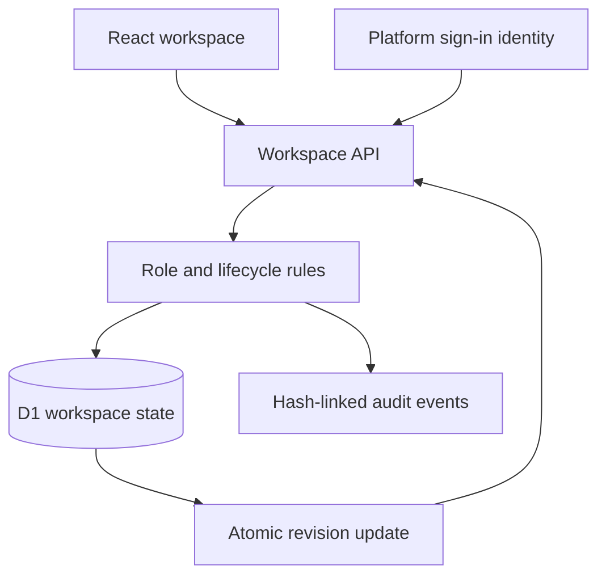

# Architecture and database

The original React/Vite source is retained under legacy/ and exposed at /legacy. Its browser-local data remains in resourceshare-v1 on the same origin. Old deployment data is not transferred across origins. The upgraded application uses the supplied React/Vinext server starter and Cloudflare Workers, because the previous static Vite build had no place to enforce permissions or coordinate shared bookings.

## Physical database

workspaces: id TEXT PRIMARY KEY; revision INTEGER NOT NULL DEFAULT 0; data TEXT NOT NULL; updated_at TEXT NOT NULL. The schema is defined in db/schema.ts; the initial SQL migration is drizzle/0000_sweet_slipstream.sql. No schema changes are performed inside request handlers.

The id is campus:one for the authenticated institutional workspace, or demo:<random bearer-session UUID> for an isolated fictional workspace. D1 sessions read from the primary. An update is accepted only when UPDATE workspaces ... WHERE id=? AND revision=? changes exactly one row. Zero changed rows produces HTTP 409, preventing the second of two stale concurrent requests from allocating a conflicting slot. Domain checks and the booking/audit update share the same state document and therefore the same atomic update. There is no in-memory or localStorage coordination for authoritative records.

## Logical records inside data

- profiles: stable platform ID, display name, email, institutional status, approved training, role and institution.
- resources: ID, owner, category, location, safety requirements, deposit amount and maintenance state.
- bookings: resource/borrower IDs, sequence, interval, purpose, team note, status, private pass, agreement snapshot, timestamps, condition reports, extension request and deposit ledger status.
- incidents: booking/resource/reporting user, severity, original description, resolution and reviewer.
- certificates: evidence reference, training identifier, reviewer and verification status. There are no file bytes.
- audit: event ID, timestamp, actor, action, reference, previous SHA-256 hash and current hash.
- notifications: user-scoped in-app messages.
- feedback: one rating and comment per completed borrowing.
- policy: max open requests, max duration, no-show grace and borrowing agreement.

## Authorization

Hosting identity headers are trusted only behind the Sites dispatch boundary. Anonymous production writes require authentication. New signed-in users start as students pending institutional review. RESOURCE_ADMIN_EMAILS is a server-only allowlist; the Site owner's account is bootstrapped there. Administrators may verify students and assign resource-owner roles. The request body never establishes a production role. Student views omit other borrowers' booking details, private access tokens and direct profile data. Manager access is checked again for each write. Demo role selection is accepted only when a random isolated-demo cookie resolves a workspace. Demo cookies are HttpOnly, SameSite=Strict and Secure on HTTPS. Plain HTTP cookie handling is restricted to named local preview hosts.

## Allocation

Requests are ordered by a monotonic per-workspace sequence. Overlapping live requests wait. Owners cannot approve over an allocated interval or bypass an earlier overlapping pending/waiting request. Cancellation, verified return, maintenance completion or a no-show sweep promotes the earliest eligible compatible request to requested. Promotion does not grant access until the owner approves it. Policy caps the number of open requests and the duration of each request. It is not a weighted needs-based fairness algorithm.

## Boundaries and scaling

The single-row JSON model deliberately gives the hackathon a small, atomic consistency surface. It serializes campus writes and grows with history. Production adoption needs normalized records, indexes, pagination, rate limits, expiring demo cleanup, retention rules, event anchoring and an independent security review. A 10,000-event guard bounds individual demo histories. Cross-institution federation is not implemented. Hash linking detects inconsistent edits but does not stop a privileged database operator from regenerating a chain. State updates use application authorization rather than end-user database RLS.
